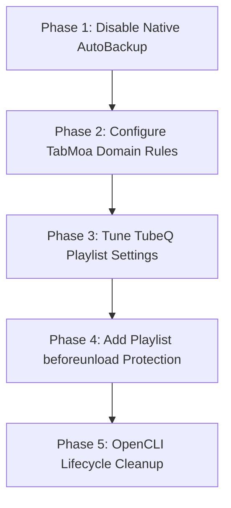

# Memory Reduction & Tab Management Action Plan

This plan outlines concrete strategies, configuration changes, and automation rules to identify memory hogs, free system RAM and swap, auto-close abandoned automation tabs, put inactive tabs to sleep, clean up social tabs via **TabMoa**, and condense YouTube tabs via **TubeQ** into an unpinned playlist protected from accidental closure.

---

## 1. Diagnostics: Identifying Memory Hogs

### System & Browser Memory Baseline
On macOS, memory pressure is driven by active resident memory (RSS), compressed memory (`vm_stat`), and disk swap (`sysctl vm.swapusage`). As observed:
- **Google Chrome**: 65 processes, ~6.5 GB RSS, 86 GB virtual address space.
- **Microsoft Edge**: 56 processes, ~4.5 GB RSS, 83 GB virtual address space.
- **Spotlight (`mds` + `mdworker`)**: ~1.0 GB RSS indexing backup drives.
- **Compressed Memory / Swap**: Over 16 GB of compressed memory and swap due to prolonged multi-day disk/backup tasks.

### Quick Diagnostic One-Liners
Add these aliases or check commands to inspect hogs in real time:

```bash
# 1. Top 15 memory-consuming applications (aggregated RSS in MB)
python3 -c "
import subprocess
out = subprocess.check_output(['ps', '-A', '-o', 'rss,comm'], text=True)
procs = {}
for line in out.strip().splitlines()[1:]:
    parts = line.strip().split(None, 1)
    if len(parts) == 2 and parts[0].isdigit():
        rss, comm = int(parts[0]), parts[1].split('/')[-1]
        procs[comm] = procs.get(comm, 0) + rss
for comm, rss in sorted(procs.items(), key=lambda x: x[1], reverse=True)[:15]:
    print(f'{comm:<30} {rss/1024:>8.1f} MB')
"

# 2. Check current swap and memory pressure
sysctl vm.swapusage
memory_pressure
```

### In-Browser Diagnostics
- **Chromium Task Manager**: Press `Shift + Esc` inside Chrome or Edge to view per-tab memory footprint and JavaScript heap size.
- **Tab Discard Inspection**: Navigate to `chrome://discards/` (or `edge://discards/`) to see which tabs are eligible for memory sleeping, their reactivations, and memory footprints.

---

## 2. OpenCLI & Automation Tab Cleanup

### The Cause
Tasks spawned by OpenCLI, ChatGPT-OpenCLI, or web scrapers open browser pages via the Chrome DevTools Protocol (CDP) or browser extensions. If a script fails, completes without closing its target, or encounters timeouts, the tab remains alive in Chrome/Edge, each retaining 150–350 MB of RAM.

### Solutions
1. **Automation Script Exit Hooks**:
   - In OpenCLI / task scripts, ensure every browser runner wraps operations in a `finally` block:
     ```javascript
     try {
       await runTask(page);
     } finally {
       if (!debugMode) await page.close();
     }
     ```
2. **TabMoa Domain Cleanup for Automation Tabs**:
   - Configure TabMoa's Domain Cleanup to automatically close stale automation endpoints after 15–30 minutes of inactivity:
     - `pattern: "localhost", durationMinutes: 20`
     - `pattern: "127.0.0.1", durationMinutes: 20`
     - `pattern: "extension://", durationMinutes: 30`
     - `pattern: "chrome://", durationMinutes: 30`

---

## 3. Forcing Inactive Tabs to Sleep (Discarding & Freezing)

### Why Tabs Resist Sleeping
Tabs will not sleep if they:
1. Play audio or maintain an open WebAudio context (e.g. paused YouTube video).
2. Maintain active WebSockets, Server-Sent Events, or long-polling workers.
3. Are pinned (Chromium by default protects pinned tabs from automatic memory discarding).

### Implementation Steps
1. **Enable Native Chromium Memory Saver**:
   - Go to `chrome://settings/performance` (or `edge://settings/system`).
   - Turn **Memory Saver** ON and select **Maximum** (discards tabs more aggressively after short idle times).
2. **Enable TabMoa Low-Value Discard**:
   - In TabMoa (`src/model/TabCleaner.ts`), toggle:
     - `lowValueDiscardEnabled = true`
     - `lowValueDiscardMinutes = 30` (or 45)
   - This automatically discards search results (`google.com/search`), social feeds (`reddit.com`, `news.ycombinator.com`, `linkedin.com/feed`), and duplicate research tabs via `chrome.tabs.discard()`.
3. **Marvellous Suspender Integration**:
   - In `marvellous-addon`, set background tab suspension to 20 minutes with "Do not suspend audible tabs" enabled, but "Do not suspend pinned tabs" reviewed.

---

## 4. Automatic Social Media Tab Cleanup via TabMoa

TabMoa already includes a domain-based expiration engine in [TabCleaner.ts](file:///Users/john/chrome/tabmoa/src/model/TabCleaner.ts#L30).

### Recommended Rules Configuration
In TabMoa settings (**TabMoa Options > Tab Cleaner**), enable **Domain Cleanup** and set the following rules:

| Pattern | Idle Timeout | Purpose |
| :--- | :--- | :--- |
| `instagram.com` | `15` mins | Auto-close feed and reel tabs |
| `facebook.com` | `15` mins | Auto-close feed and notification tabs |
| `twitter.com` / `x.com` | `15` mins | Auto-close timeline and post tabs |
| `threads.net` | `15` mins | Auto-close thread tabs |
| `reddit.com` | `20` mins | Auto-close browsed subreddits and comment threads |
| `linkedin.com/feed` | `20` mins | Auto-close feed while keeping job/inbox tabs intact |
| `news.ycombinator.com` | `30` mins | Auto-close read comment pages |
| `google.com/search` | `20` mins | Auto-close abandoned search queries |

Also enable **Auto-close empty new tabs** (`autoCloseEmptyNewTabs: true`).

---

## 5. YouTube Tab Condensation with TubeQ

### Requirements
- Collect all open YouTube video tabs across all windows.
- Combine them into a single playlist tab using **TubeQ**.
- The playlist tab must **NOT be pinned**.
- The playlist tab must be **protected from accidental closure via keyboard shortcut**.

### Step 1: Configure TubeQ Options (Unpinned Playlist)
In [tubeq/js/events.js](file:///Users/john/chrome/tubeq/js/events.js#L679):
1. Open TubeQ Options (`chrome-extension://<id>/options.html`).
2. Uncheck **Pin playlist tab** (sets `pinPlaylistTab: false`).
3. Ensure **Close source tabs after adding** is checked (`closeTabs: true`).
4. Result: When TubeQ creates or updates the playlist, the source tabs are closed, and the resulting playlist tab remains a regular unpinned tab.

### Step 2: Prevent Accidental Playlist Closure
Because unpinned tabs can easily be closed by pressing `Cmd + W` or running bulk tab cleanup shortcuts (`Ctrl + Command + 8` or `Ctrl + Command + 0` in [browser-command-shortcuts](file:///Users/john/chrome/browser-command-shortcuts/README.md)):

1. **TubeQ BeforeUnload Protection**:
   In [tubeq/js/content.js](file:///Users/john/chrome/tubeq/js/content.js) or `events.js`, inject a lightweight `beforeunload` listener into generated playlist pages:
   ```javascript
   // If this is a generated TubeQ playlist with > 1 video:
   window.addEventListener('beforeunload', (e) => {
     if (location.href.includes('list=')) {
       e.preventDefault();
       e.returnValue = 'TubeQ playlist is active. Are you sure you want to close it?';
       return e.returnValue;
     }
   });
   ```
   *Benefit*: Pressing `Cmd + W` on the playlist tab triggers a browser confirmation prompt instead of immediately closing the playlist and losing queued videos.

2. **Browser Command Shortcuts Whitelist Protection**:
   In [browser-command-shortcuts](file:///Users/john/chrome/browser-command-shortcuts/README.md), configure exclusion rules to protect `youtube.com/playlist` URLs from `close-tabs-to-right` and `close-current-tab-group`.

---

## 6. Time Machine `backupd` Memory Prevention

- **Problem**: When `AutoBackup = 1`, macOS's `backupd-helper` triggers `backupd` every 24 hours, scanning 9+ million files, filling file caches, and compressing 75 GB of RAM into swap.
- **Action**:
  1. Open **System Settings > General > Time Machine > Options...**.
  2. Set **Backup Frequency** to **Manually**.
  3. (Or run `sudo tmutil disable` once with admin rights).
- **Result**: macOS will never wake `backupd` automatically during your active working hours. Backups will occur strictly on demand or when scheduled by `idle-maintenance/time_machine_backup.py` during idle overnight windows (8 PM – 7 AM).

---

## 7. Phased Implementation Roadmap



1. **Immediate (No Code Changes)**:
   - Toggle Time Machine frequency to **Manually**.
   - Enable **Domain Cleanup** in TabMoa options and add social patterns.
   - Uncheck **Pin playlist tab** in TubeQ options.
2. **Short-Term (Extension Enhancements)**:
   - Add `beforeunload` confirmation in TubeQ for generated playlist tabs.
   - Whitelist `youtube.com/playlist` in `browser-command-shortcuts`.
   - Enable `lowValueDiscardEnabled` in TabMoa for background search & feed tabs.
3. **Automation Maintenance**:
   - Enforce tab cleanup on completion/timeout in OpenCLI & ChatGPT-OpenCLI runners.
